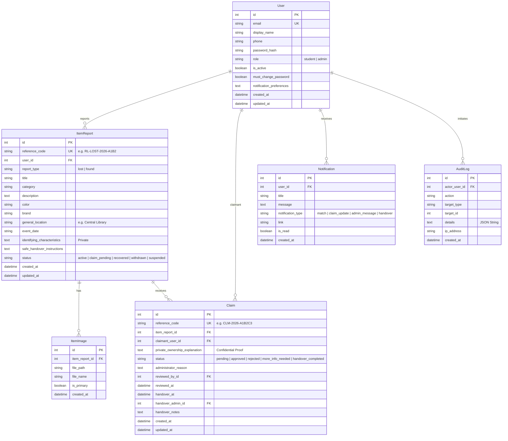
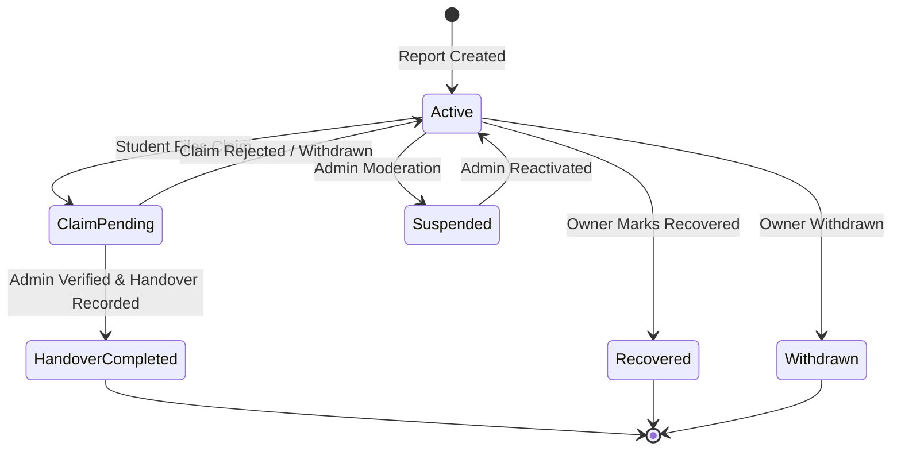

# ReturnLoop LPU - Database Architecture & Schema

ReturnLoop LPU utilizes a normalized relational schema modeled in SQLAlchemy. For local development and demonstrations, it runs on SQLite (`instance/returnloop.db`), designed for migration to PostgreSQL.

---

## Entity Relationship Overview

---

## Detailed Table Specifications

### 1. `users`
| Column | Type | Constraints | Description |
|---|---|---|---|
| `id` | Integer | Primary Key, Auto Increment | Unique internal identifier |
| `email` | String(120) | Unique, Not Null, Index | Institutional university email address |
| `display_name` | String(100) | Not Null | Student or Staff display name |
| `phone` | String(25) | Nullable | Optional contact number (private) |
| `password_hash` | String(255) | Not Null | Werkzeug-generated pbkdf2:sha256 hash |
| `role` | String(20) | Default 'student', Not Null | `student` or `admin` |
| `is_active` | Boolean | Default True, Not Null | Account active status flag |
| `must_change_password` | Boolean | Default False, Not Null | Enforces initial password update on seeded admin |
| `notification_preferences` | Text | Default JSON | User preference flags for alerts |
| `created_at` | DateTime | Default UTC now | Registration timestamp |
| `updated_at` | DateTime | Auto-updated UTC now | Modification timestamp |

### 2. `item_reports`
| Column | Type | Constraints | Description |
|---|---|---|---|
| `id` | Integer | Primary Key, Auto Increment | Unique internal identifier |
| `reference_code` | String(30) | Unique, Not Null, Index | Public tracking identifier (e.g. `RL-LOST-2026-3F8A`) |
| `user_id` | Integer | Foreign Key (`users.id`), On Delete Cascade | Reporter user ID |
| `report_type` | String(10) | Not Null, Index | `lost` or `found` |
| `title` | String(150) | Not Null, Index | Item name / headline |
| `category` | String(50) | Not Null, Index | Category (Electronics, ID & Cards, etc.) |
| `description` | Text | Not Null | Public description of appearance and context |
| `color` | String(50) | Not Null, Index | Primary color trait for matching |
| `brand` | String(80) | Nullable | Brand or manufacturer name |
| `general_location` | String(100) | Not Null, Index | LPU campus location (e.g. Block 34, Central Library) |
| `event_date` | String(20) | Not Null | ISO YYYY-MM-DD date when lost or found |
| `identifying_characteristics` | Text | Nullable | Confidential verification notes (Owner & Admin only) |
| `safe_handover_instructions` | Text | Nullable | Custody location and safe recovery guidance |
| `status` | String(20) | Default 'active', Index | `active`, `claim_pending`, `recovered`, `withdrawn`, `suspended` |

### 3. `claims`
| Column | Type | Constraints | Description |
|---|---|---|---|
| `id` | Integer | Primary Key | Unique internal claim ID |
| `reference_code` | String(30) | Unique, Index | Case tracking number (e.g. `CLM-2026-9E4B`) |
| `item_report_id` | Integer | Foreign Key (`item_reports.id`) | Target found item |
| `claimant_user_id` | Integer | Foreign Key (`users.id`) | Claimant student ID |
| `private_ownership_explanation` | Text | Not Null | Confidential proof submitted by student |
| `status` | String(25) | Default 'pending', Index | `pending`, `approved`, `rejected`, `more_info_needed`, `handover_completed` |
| `administrator_reason` | Text | Nullable | Administrator verification or rejection justification |
| `reviewed_by_id` | Integer | Foreign Key (`users.id`), Nullable | Verifying administrator user ID |
| `handover_at` | DateTime | Nullable | Timestamp of in-person handover |
| `handover_admin_id` | Integer | Foreign Key (`users.id`), Nullable | Admin who verified ID and gave item |
| `handover_notes` | Text | Nullable | Student ID verified, logbook signatures |

---

## State Transition Rules

